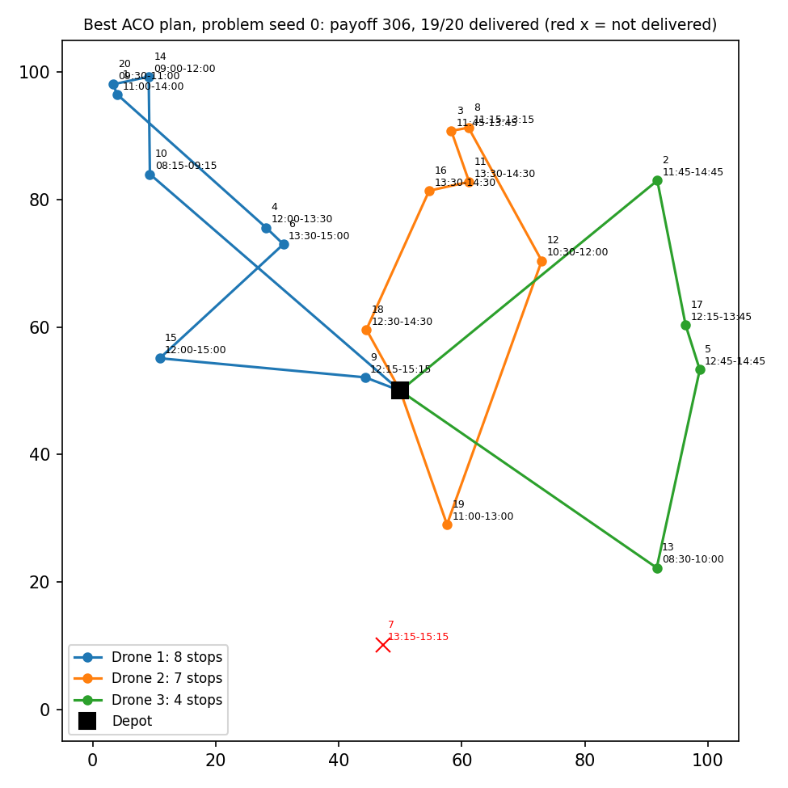
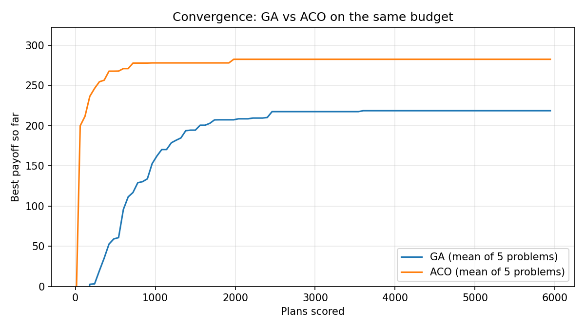

# Drone Delivery Optimisation

[](https://github.com/jocelync07/drone-delivery-optimisation/actions/workflows/tests.yml)

Planning delivery routes for a drone fleet with **battery limits and delivery time windows**, a vehicle routing problem with time windows (VRPTW). The project covers three AI techniques:

1. **Optimisation:** a genetic algorithm (GA) and ant colony optimisation (ACO), compared on the same budget.
2. **Adversarial search:** two rival fleets claiming deliveries in turns, solved with negamax and alpha-beta pruning.
3. **Game theory:** should rival fleets keep to their own zones or compete everywhere? Payoff matrix, Nash equilibrium and a repeated game.



## The problem

- A depot in the middle of a 100 × 100 map, 3 drones, and 20 requests, each with a delivery window (for example 11:00–13:00).
- A drone can fly at most 180 distance units per day and must be home by 16:00. It waits if it arrives early, and is late if it arrives after the window closes.
- Every method is scored by the same function ([`drones/evaluate.py`](drones/evaluate.py)):

  `payoff = 30 per delivery − 0.5 per distance unit − 1 per minute late − 20 per request not delivered − 1000 per broken limit`

Problems are generated from a seed ([`drones/instance.py`](drones/instance.py)), so every result can be reproduced exactly.

## 1. Genetic algorithm vs ant colony optimisation

| | Genetic algorithm | Ant colony optimisation |
|---|---|---|
| A solution is | an order of the 20 requests | built stop by stop by each ant |
| Limits handled by | a first-fit decoder: each request goes to the first drone that can still fit it | ants only choose requests they can still fit |
| Search | tournament selection, order crossover, swap/reversal mutation, elitism | pheromone × desirability (close, little waiting or lateness); evaporation; best ants reinforce their routes |

Both get exactly **6,000 scored plans** on each of 5 random problems:

| Method | Mean payoff | Std | Mean delivered (of 20) | Wins |
|---|---|---|---|---|
| GA | 218.6 | 63.4 | 17.4 | 0/5 |
| **ACO** | **282.5** | **22.7** | **18.6** | **5/5** |



ACO won on all five problems and was far more consistent. It also reaches a good plan within the first few hundred evaluations, because each ant builds a feasible route step by step, guided by distance and the time windows. The GA has to discover a good order blindly through crossover and mutation. Its first-fit decoder keeps every plan feasible, but it can't see the time windows, so it sometimes accepts late deliveries (problem 1: 31 minutes late in total).

## 2. Rival fleets: adversarial search

Two fleets (2 drones each) take turns claiming one of 10 requests, or passing. The search value is payoff(A) − payoff(B): A maximises it and B minimises it. [`drones/compete.py`](drones/compete.py) implements negamax with alpha-beta pruning, with claims ordered nearest-first so pruning happens early.

| Search, 4 moves ahead | Nodes visited | Same best move? |
|---|---|---|
| Plain negamax | 27,879 | yes |
| **Alpha-beta** | **635** (98% fewer) | yes |

| Fleet A | Fleet B | A payoff | B payoff |
|---|---|---|---|
| greedy | greedy | 21.8 | 17.1 |
| **negamax** | greedy | **60.5** | 17.1 |
| greedy | **negamax** | 21.8 | **55.8** |

A fleet that looks ahead earns roughly **three times** as much as one that only takes the best claim right now. The greedy fleet stops after one delivery, because no single next claim pays for itself. The searching fleet sees that a chain of nearby claims does.

## 3. Share zones or compete?

Fleet A owns the west half of the map and fleet B the east, and each is penalised for undelivered requests in its own zone. Each picks **Share** (plan with ACO in its own zone) or **Compete** (plan over the whole map). When both fleets visit the same request, the first to arrive is paid.

| A \ B | Share | Compete |
|---|---|---|
| **Share** | 56.1, 216.5 | −93.9, 140.7 |
| **Compete** | 80.7, 16.5 | 10.7, −139.3 |

- **Compete is dominant for A and Share is dominant for B**, so the only Nash equilibrium is (Compete, Share).
- The best total outcome is (Share, Share), at 272.6 against 97.2 at equilibrium. Competition costs the two fleets together 175, almost all of it paid by B.
- The asymmetry comes from the map: B's zone in this problem is richer. A gains by raiding it, while B's drones are better used at home.

In a **20-round repeated game**, tit-for-tat and grim trigger scored best (43.4 per round), ahead of always-compete (29.9) and always-share (18.6). Strategies that punish raiding make raiding less attractive. Full results: [`results/results.md`](results/results.md).

## Run it

Needs Python 3.9 or newer.

```bash
pip install -r requirements.txt
python experiments.py           # all three parts, about 2 minutes; writes results/
python experiments.py --quick   # smaller version for a fast check
pytest -v
```

## Project structure

```
drones/
  instance.py   problem generator (seeded)
  evaluate.py   the shared scoring function, route simulation, first-fit decoder
  ga.py         genetic algorithm
  aco.py        ant colony optimisation
  compete.py    rival fleets: negamax with alpha-beta pruning
  game.py       payoff matrix, dominance, Nash equilibria, repeated game
experiments.py  runs everything and writes results/
tests/          scoring by hand, feasibility, determinism, pruning correctness, game analysis
```
